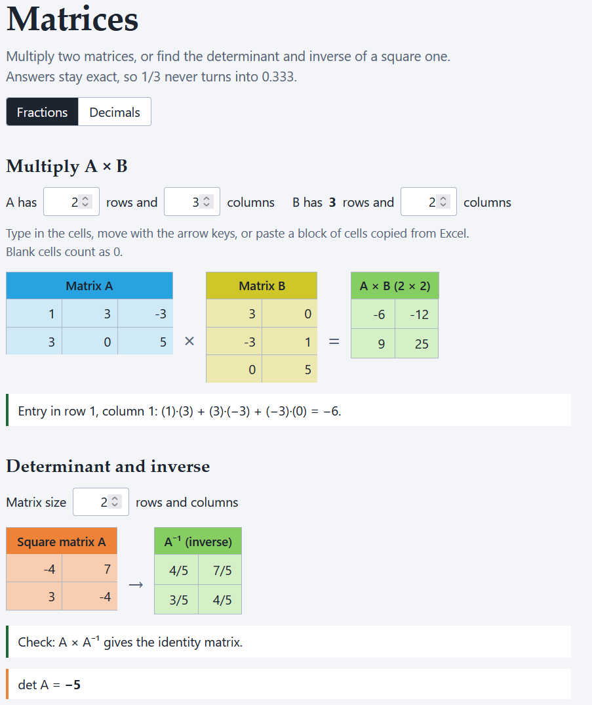
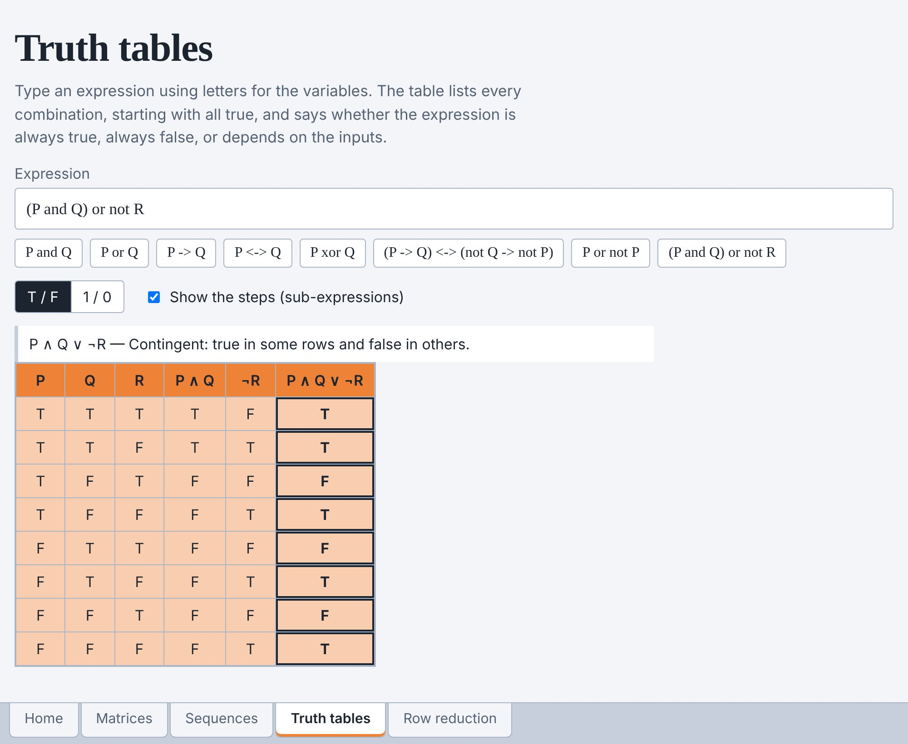

# Discrete Math Tools

Four small calculators built from the Excel sheets I made for my WGU discrete mathematics coursework. Each page shows its work and has short notes underneath.

**Live site:** https://tweevilly.github.io/Discrete_Math_Tools/

| Page | What it does |
| --- | --- |
| [Matrices](matrices.html) | Multiply two matrices, or find the determinant and inverse of a square matrix. |
| [Sequences and series](sequences.html) | Geometric and arithmetic sequences: nth term, a table of terms, sums, and whether the infinite sum converges. |
| [Truth tables](truth-tables.html) | Truth table for a logic or Boolean expression, tautology check, and equivalence of two expressions. |
| [Row reduction](row-reduction.html) | Echelon and reduced echelon form, rank, the solution of a linear system, and every row operation. |




## Features

- Exact answers. Numbers are stored as fractions (using BigInt), so 1/3 stays 1/3. A toggle switches the display to decimals.
- Paste a block of cells straight from Excel into any matrix grid.
- Boolean algebra shorthand from my notes works as well as the textbook symbols: `x + xy` is OR and AND, `-x` is NOT, and `->` and `<->` are implies and if-and-only-if.
- Tests of the notes' own examples (the matrix product, the inverse, the 2^n sequence, and the Boolean laws).
- No build step, no dependencies, and nothing is sent anywhere. Plain HTML, CSS, and JavaScript.

## Run it locally

Open `index.html` in a browser. It works straight from the file system.

To run the tests (Node 18 or newer, no install needed):

```
node --test
```

## Publish it with GitHub Pages

1. Push this folder to a repository named `Discrete_Math_Tools`.
2. In the repository, go to Settings, then Pages.
3. Under "Build and deployment", choose "Deploy from a branch", pick `main` and `/ (root)`, and save.
4. After a minute the site is live at `https://<your-username>.github.io/Discrete_Math_Tools/`.
   
## Layout

```
index.html, matrices.html, sequences.html, truth-tables.html, row-reduction.html
assets/   style.css, ui.js (shared page code), and the math:
          fraction.js, matrices.js, rref.js, sequences.js, logic.js
tests/    math.test.js
```


## Credit

Coursework: WGU discrete mathematics. The notes and spreadsheets these tools replace are my own.
